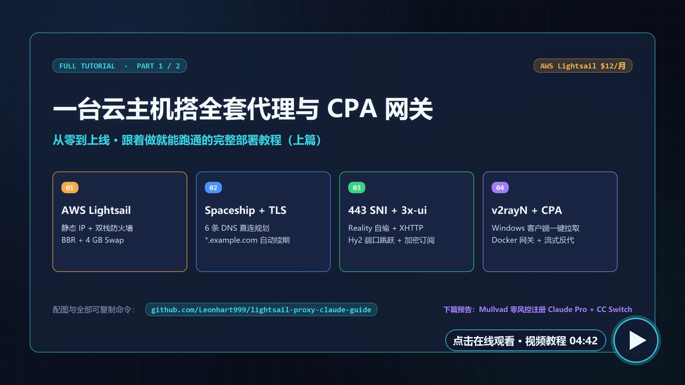
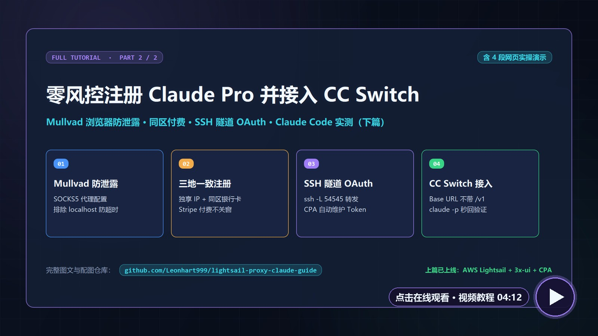
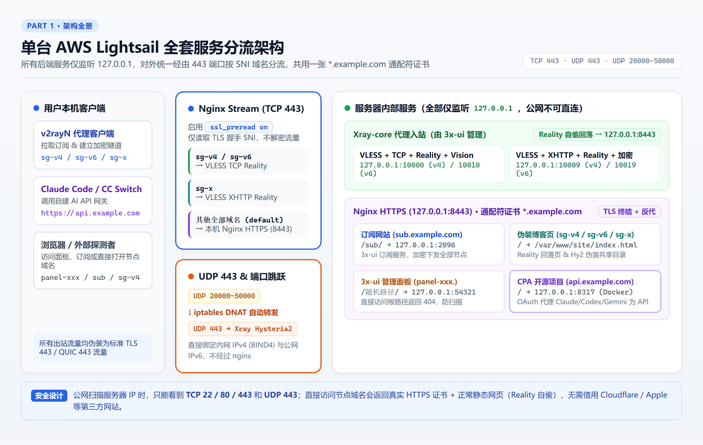

# Lightsail 自建代理节点、CPA 网关与 Claude Pro 接入完整教程

本仓库整理了一套从零开始的完整图文实践教程，涵盖 **云服务器搭建 → 域名与通配符证书 → 3x-ui 代理与订阅网站 → v2rayN 客户端 → 开源项目 CPA 部署 → Mullvad 指纹浏览器注册 Claude Pro → OAuth 接入 CPA → CC Switch 连接 Claude Code** 全链路。

> **懒人包**：不想手动敲命令？把 [LAZY-PACK.md](LAZY-PACK.md) 整份发给能执行终端命令的 AI 助手（Claude Code、Codex CLI 等），AI 会按顺序自动完成服务器、证书、节点、订阅、CPA 和 Claude Code 配置。注册账号、付款、购买域名、网页授权这几步需要你本人操作，AI 会停下来一步步教你。

## 视频教程

两篇视频均为 1080p、中文配音与字幕，在线播放页支持上下篇切换和章节跳转。

<table>
  <tr>
    <td width="50%" align="center">
       
      <b>上篇：服务器、代理节点与 CPA 部署（04:42）</b> 
      <a href="https://leonhart999.github.io/lightsail-proxy-claude-guide/#part1">在线播放</a> ｜
      <a href="https://github.com/Leonhart999/lightsail-proxy-claude-guide/releases/download/v1.0.0/Lightsail_Proxy_CPA_Part1.mp4">MP4（23 MB）</a> ｜
      <a href="https://github.com/Leonhart999/lightsail-proxy-claude-guide/releases/download/v1.0.0/Lightsail_Proxy_CPA_Part1.srt">SRT 字幕</a>
    </td>
    <td width="50%" align="center">
       
      <b>下篇：注册 Claude Pro 与 CC Switch 接入（04:12，含网页实操演示）</b> 
      <a href="https://leonhart999.github.io/lightsail-proxy-claude-guide/#part2">在线播放</a> ｜
      <a href="https://github.com/Leonhart999/lightsail-proxy-claude-guide/releases/download/v1.0.0/Lightsail_Proxy_CPA_Part2.mp4">MP4（21 MB）</a> ｜
      <a href="https://github.com/Leonhart999/lightsail-proxy-claude-guide/releases/download/v1.0.0/Lightsail_Proxy_CPA_Part2.srt">SRT 字幕</a>
    </td>
  </tr>
</table>

## 教程目录

本教程分为两个独立 `README`，建议按顺序阅读与操作：

| 篇目 | 文档入口 | 涵盖内容 |
| --- | --- | --- |
| **第一篇：服务器、代理节点与 CPA 部署** | [docs/part1-server-proxy-cpa/README.md](docs/part1-server-proxy-cpa/README.md) | 1. 注册 AWS 账号 2. 创建 Lightsail 与静态 IP/防火墙 3. Spaceship 购买域名、DNS 与通配符证书 4. Nginx SNI 分流与 3x-ui 三协议代理节点 5. 建立加密订阅网站与伪装博客页 6. Windows 安装与配置 v2rayN 7. Docker 部署开源项目 CPA（CLIProxyAPI） |
| **第二篇：注册 Claude Pro 与 CC Switch 接入** | [docs/part2-claude-mullvad-ccswitch/README.md](docs/part2-claude-mullvad-ccswitch/README.md) | 1. 安装 Mullvad 指纹浏览器与 CC Switch 2. 连接自建代理节点与防泄露检测 3. 使用服务器同地区银行卡注册并订阅 Claude Pro 4. 通过 SSH 隧道将 Claude OAuth 登录到 CPA 5. 将 CPA API 接入 CC Switch 与 Claude Code |

## 架构特点

- **单一入口 443 复用**：所有后端服务（Xray、3x-ui 面板与订阅、CPA）仅监听 `127.0.0.1`，对外统一经 Nginx 443 按 SNI 域名分流。
- **Reality 自偷伪装**：伪装页面为自己域名下的静态博客，证书为 Let's Encrypt 自动续期的 `*.example.com` 通配符证书，不依赖第三方网站。
- **三协议互补**：VLESS TCP Reality Vision（主力稳妥）+ VLESS XHTTP Reality（抗干扰进阶）+ Hysteria2 端口跳跃（晚高峰高速 UDP）。
- **防风控隔离**：使用 Mullvad Browser 隔离指纹与 WebRTC 泄露，坚持“代理 IP 地区 = 银行卡地区 = 账单地址地区”三地一致。

## 安全与合规提醒

1. 文中所有 `example.com`、`<PUB4>`、`sk-cpa-...`、随机路径和密码均为**占位符**，实操时请全部替换为自己重新生成的随机值。
2. 切勿将 `.pem` 私钥、Spaceship API 密钥、3x-ui 订阅地址或 CPA 密钥上传到公开仓库或发给陌生人。
3. 将网页或个人订阅账号转为 API 使用通常不符合上游服务条款，存在限流或封号风险；本教程仅供学习与个人自用参考，请勿用于商业分发。
