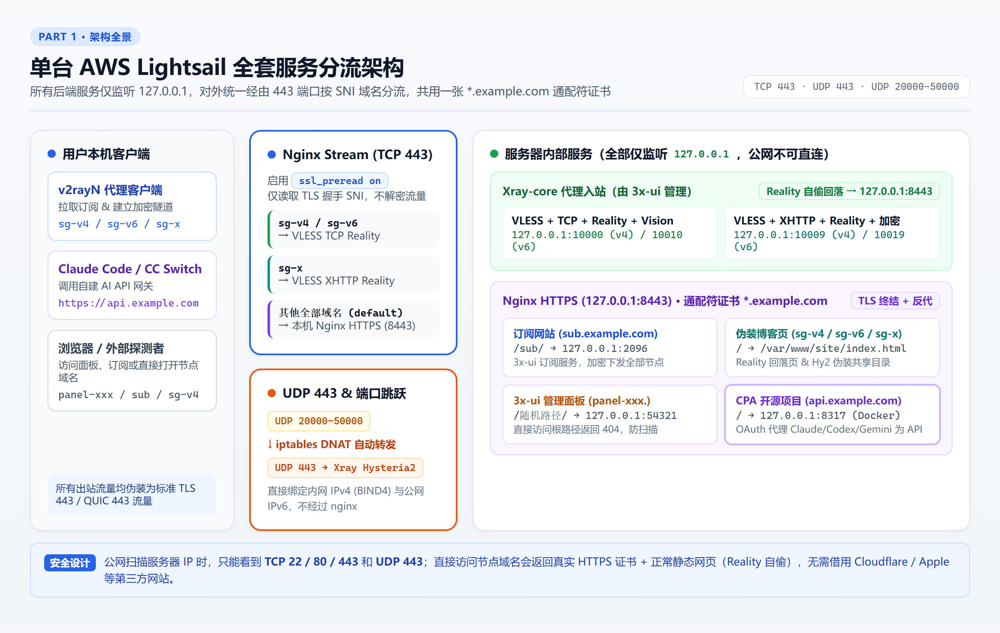
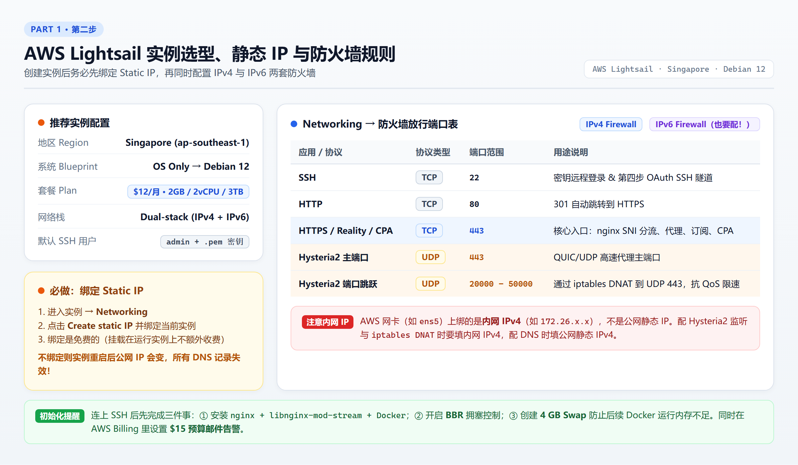
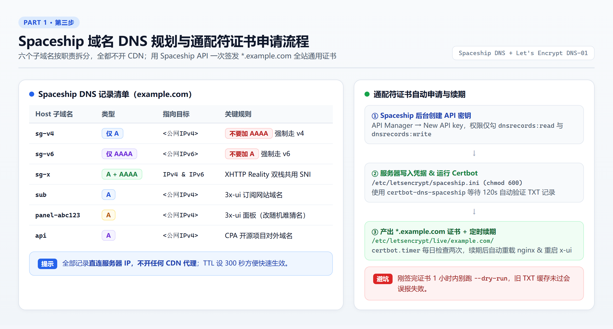
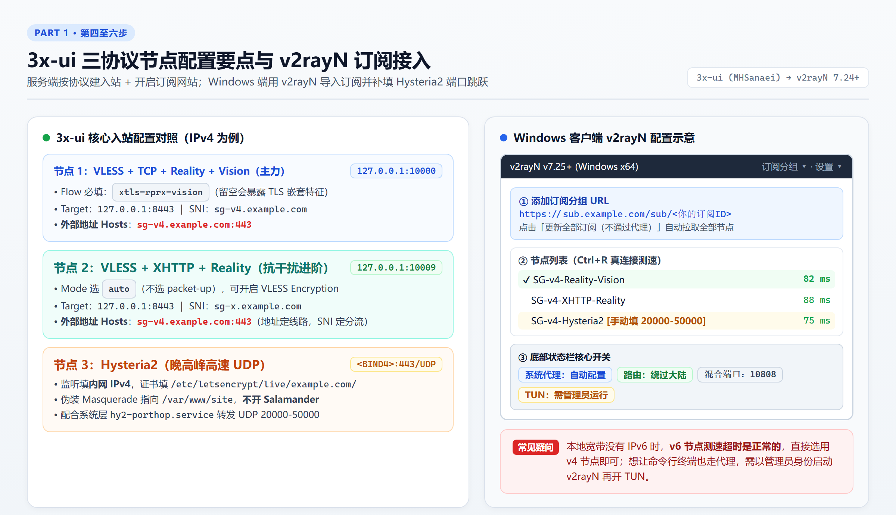
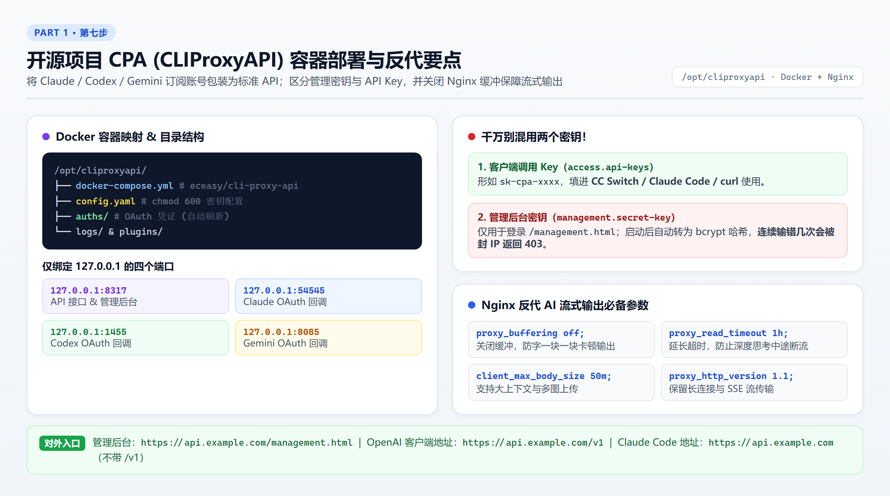

# 第一篇：AWS Lightsail 搭建代理节点、订阅网站、v2rayN 与 CPA 完整教程

> 返回首页：[总览导航](../../README.md) ｜ 下一篇：[第二篇：注册 Claude Pro 并通过 OAuth 接入 CPA 与 CC Switch](../part2-claude-mullvad-ccswitch/README.md)

本篇按从零开始的实操顺序，带你完成以下 7 个环节：
1. 注册 AWS 账号并做好安全/账单防护
2. 创建 AWS Lightsail 实例、绑定静态 IP 与配置防火墙
3. 在 Spaceship 购买域名、规划 DNS 并签发自动续期通配符证书
4. 部署 Nginx SNI 443 分流与 3x-ui（VLESS Reality / XHTTP / Hysteria2）代理节点
5. 建立加密订阅网站与 Reality 伪装博客页
6. 在 Windows 上安装与配置 v2rayN 客户端
7. 用 Docker 部署开源项目 CPA（CLIProxyAPI）并配置流式反代

> **安全提醒**：文中出现的 `example.com`、`<PUB4>`、`<PUB6>`、`<BIND4>`、`sk-cpa-...` 等均为占位符，请替换为自己的真实值。切勿将密码、密钥、订阅地址泄露或上传至公开仓库。

---

## 整体架构一览

先明确所有组件的连接关系，后续每一步配置都能一目了然：



核心设计原则：
- **所有后端仅听本机 `127.0.0.1`**，公网上只暴露 Nginx 的 `TCP 80 / 443`、SSH `TCP 22` 以及 Hysteria2 的 `UDP 443`（加端口跳跃）。
- **一张通配符证书 `*.example.com`** 供所有子域名共用，到期前自动续期。
- **Reality 自偷**：直接访问节点域名返回你自己的正常静态网页和合法证书，不借用任何大厂站点。

---

## 第一步：注册 AWS 账号

1. 前往 AWS 国际版官网 `https://aws.amazon.com` 注册新账号（不要选中国区）。
2. 提前准备：
   - **常用邮箱**：建议 Gmail / Outlook 等稳定邮箱。
   - **支持外币的信用卡或借记卡**：Visa / Mastercard，卡内预留 `$1–$2` 用于预授权扣款验证（验证通过后会自动退回）。
   - **手机号**：用于接收短信或语音验证码（`+86` 可用）。
3. 账单地址用拼音填写真实地址；支持计划选择 **Basic support - Free（免费基本支持）**。
4. 等待几分钟至数小时账号激活完成后，**立刻完成两项基础防护**：
   - **开启 MFA 两步验证**：右上角账号名 → *Security credentials* → 绑定手机验证器（如 Google Authenticator / Microsoft Authenticator）。
   - **设置月度账单告警**：进入 *Billing and Cost Management → Budgets*，新建一个 Monthly cost budget（例如 `$15`），超额即发邮件提醒，避免流量超标产生高额账单。

---

## 第二步：创建 AWS Lightsail 实例与服务器初始化



### 2.1 创建实例

1. 在 AWS 控制台顶部搜索并进入 **Lightsail** → 点击 **Create instance**。
2. 关键选项推荐：
   - **Region（地区）**：选 **美国**（对 AI 服务友好；也可按你的银行卡地区选择新加坡、东京、伦敦等）。
   - **Platform**：`Linux/Unix`
   - **Blueprint**：`OS Only` → **Debian 12**
   - **SSH key pair**：下载默认 `.pem` 私钥文件并妥善保存。
   - **Instance plan（套餐）**：
     - 仅跑翻墙节点：`$5/月` 即可。
     - **同时跑代理 + CPA 及其他 Docker 容器**：建议选 **`$12/月`（2 GB 内存 / 2 核 / 60 GB 硬盘 / 3 TB 月流量）**。
   - **网络选项**：勾选 **Dual-stack（IPv4 + IPv6）**。

### 2.2 绑定静态 IP 与放行防火墙

实例运行后，进入实例详情页 → **Networking**：

1. **创建并绑定静态 IP（必做）**：
   - 点击 **Create static IP** 并挂载到当前实例（绑定到运行中的实例不额外收费）。
   - 不绑静态 IP 的话，实例重启后公网 IP 会变，所有 DNS 解析都会失效。
   - 记下公网 IPv4（`<PUB4>`）和实例详情里的公网 IPv6（`<PUB6>`）。
2. **放行防火墙端口**（**IPv4 Firewall** 和 **IPv6 Firewall** 两个标签页都要配）：
   - `TCP 22`（SSH）
   - `TCP 80`（HTTP 跳转 HTTPS）
   - `TCP 443`（HTTPS、Reality、订阅、CPA）
   - `UDP 443`（Hysteria2 主端口）
   - `UDP 20000-50000`（Hysteria2 端口跳跃，不用 Hy2 可跳过）

### 2.3 本机配置 SSH 快捷登录

将 `.pem` 文件放到 `C:\Users\<用户名>\.ssh\` 目录下，编辑 `C:\Users\<用户名>\.ssh\config`（没有则新建，无扩展名）：

```sshconfig
Host lightsail
    HostName <你的公网IPv4>
    User admin
    IdentityFile ~/.ssh/LightsailDefaultKey.pem
    IdentitiesOnly yes
    ServerAliveInterval 60
```

> Windows 上若 SSH 提示 `.pem` 权限过宽（`UNPROTECTED PRIVATE KEY FILE`），右键 `.pem` → 属性 → 安全 → 高级 → 禁用继承并移除其他用户，只保留你自己的账户读取权限。

在终端运行 `ssh lightsail` 登录服务器。

### 2.4 服务器基础软件、BBR 与 Swap 初始化

登录后依次执行：

```bash
# 1. 更新系统并安装 nginx（带 stream 模块）、venv、sqlite3、iptables
sudo apt update && sudo apt upgrade -y
sudo apt install -y nginx libnginx-mod-stream python3-venv curl sqlite3 iptables

# 2. 安装 Docker
curl -fsSL https://get.docker.com | sudo sh

# 3. 开启 BBR 拥塞控制（显著改善跨境吞吐与抗丢包）
echo -e "net.core.default_qdisc=fq\nnet.ipv4.tcp_congestion_control=bbr" | sudo tee /etc/sysctl.d/99-bbr.conf
sudo sysctl --system

# 4. 创建 4 GB Swap（防止 2 GB 内存运行多个容器或构建镜像时 OOM）
sudo fallocate -l 4G /swapfile && sudo chmod 600 /swapfile
sudo mkswap /swapfile && sudo swapon /swapfile
echo '/swapfile none swap sw 0 0' | sudo tee -a /etc/fstab
echo 'vm.swappiness=10' | sudo tee /etc/sysctl.d/99-swap.conf && sudo sysctl --system
```

查看网卡名与内网 IPv4（AWS 网卡绑的是内网 IP，如 `172.26.x.x`，后面配 Hysteria2 和 iptables 会用到）：

```bash
ip -br addr
```

记下三个值：公网网卡名 `<NIC>`（通常为 `ens5`）、内网 IPv4 `<BIND4>`、公网 IPv6 `<PUB6>`。

---

## 第三步：在 Spaceship 购买域名并签发通配符证书



### 3.1 购买域名

1. 打开 `https://www.spaceship.com` 注册并登录（支持支付宝和信用卡）。
2. 搜索并购买一个域名（`.online`、`.xyz` 等首年价格低廉，注意核对续费价格）。

### 3.2 添加 DNS 记录

进入 Spaceship 后台 → **Domain List** → 点击你的域名 → **DNS**，添加以下 6 条子域名记录（**全部直连服务器 IP，不开任何 CDN 代理**，TTL 设为 `300`）：

| 子域名（Host） | 类型 | 记录值 | 说明 |
| --- | --- | --- | --- |
| `sg-v4` | **仅 A** | `<PUB4>` | V4 节点域名（**不要加 AAAA**） |
| `sg-v6` | **仅 AAAA** | `<PUB6>` | V6 节点域名（**不要加 A**） |
| `sg-x` | **A + AAAA** | `<PUB4>` 和 `<PUB6>` | XHTTP Reality 双栈共用 SNI |
| `sub` | **A** | `<PUB4>` | 3x-ui 订阅网站域名 |
| `panel-abc123` | **A** | `<PUB4>` | 3x-ui 面板域名（请自定随机难猜字符串） |
| `api` | **A** | `<PUB4>` | CPA 服务对外域名 |

### 3.3 创建 Spaceship DNS API 密钥

1. Spaceship 后台进入 **API Manager** → **New API key**。
2. 权限**只勾选** `dnsrecords:read` 和 `dnsrecords:write`。
3. 妥善记录 **API key** 与 **API secret**（secret 仅展示一次）。

### 3.4 申请通配符证书并配置自动续期

在服务器上用虚拟环境安装 `certbot` 与 `certbot-dns-spaceship`，走 DNS-01 验证签发 `*.example.com`：

```bash
sudo python3 -m venv /opt/certbot
sudo /opt/certbot/bin/pip install certbot certbot-dns-spaceship

sudo install -d -m 700 /etc/letsencrypt
sudo install -m 600 /dev/null /etc/letsencrypt/spaceship.ini
sudo tee /etc/letsencrypt/spaceship.ini >/dev/null <<'EOF'
[spaceship]
api_key = <你的Spaceship_API_Key>
api_secret = <你的Spaceship_API_Secret>
EOF

# 将 example.com 替换为你的域名
sudo /opt/certbot/bin/certbot certonly --authenticator dns-spaceship \
  --dns-spaceship-credentials /etc/letsencrypt/spaceship.ini \
  --dns-spaceship-propagation-seconds 120 \
  --key-type ecdsa --cert-name example.com -d '*.example.com' -d 'example.com'
```

证书签发成功后存放在 `/etc/letsencrypt/live/example.com/`，有效期 90 天。配置 systemd 定时自动续期及续期后重载钩子：

```bash
sudo tee /etc/systemd/system/certbot.service >/dev/null <<'EOF'
[Unit]
Description=Certbot renewal (venv)
[Service]
Type=oneshot
ExecStart=/opt/certbot/bin/certbot -q renew
EOF

sudo tee /etc/systemd/system/certbot.timer >/dev/null <<'EOF'
[Unit]
Description=Run certbot renew twice daily
[Timer]
OnCalendar=*-*-* 00,12:00:00
RandomizedDelaySec=43200
Persistent=true
[Install]
WantedBy=timers.target
EOF

sudo install -d -m 755 /etc/letsencrypt/renewal-hooks/deploy
sudo tee /etc/letsencrypt/renewal-hooks/deploy/reload-nginx.sh >/dev/null <<'EOF'
#!/bin/sh
set -e
systemctl reload nginx
systemctl restart x-ui 2>/dev/null || true
EOF
sudo chmod 755 /etc/letsencrypt/renewal-hooks/deploy/reload-nginx.sh

sudo systemctl daemon-reload && sudo systemctl enable --now certbot.timer
```

> **避坑**：刚签发完证书 1 小时内不要执行 `certbot renew --dry-run`，因旧 TXT 验证记录尚在 DNS 缓存中，会误报失败；至少间隔 1 小时后再演练。

---

## 第四步 & 第五步：部署代理节点与建立订阅网站



### 4.1 制作静态伪装网页（Reality 回落站）

不要使用 Nginx 默认欢迎页，也不要出现“代理 / VPN / 节点”等敏感字样：

```bash
sudo mkdir -p /var/www/site /etc/nginx/stream.d
sudo tee /var/www/site/index.html >/dev/null <<'EOF'
<!doctype html>
<html lang="en">
<head>
  <meta charset="utf-8">
  <meta name="viewport" content="width=device-width,initial-scale=1">
  <title>Personal Notes</title>
  <style>
    body{max-width:680px;margin:60px auto;padding:0 20px;font:16px/1.7 system-ui,sans-serif;color:#222}
    @media(prefers-color-scheme:dark){body{background:#111;color:#ddd}}
    h1{font-size:1.5rem} li{margin:.6rem 0} small{color:#888}
  </style>
</head>
<body>
  <h1>Notes &amp; Bookmarks</h1>
  <p>Personal technical archive.</p>
  <ul>
    <li>Linux systemd timer notes <small>2026-10-12</small></li>
    <li>Nginx stream SNI routing snippet <small>2026-10-18</small></li>
  </ul>
</body>
</html>
EOF
```

### 4.2 配置 Nginx 443 SNI 分流与 8443 反代

1. 删除默认站点并微调 `/etc/nginx/nginx.conf`：
   ```bash
   sudo rm -f /etc/nginx/sites-enabled/default
   ```
   编辑 `/etc/nginx/nginx.conf`，在 Debian 默认配置上做三处修改：
   - 顶部 `pid` 附近新增：`worker_rlimit_nofile 65535;`
   - 将 `events { worker_connections 768; }` 改为 `4096`
   - 在 `events { ... }` 之后、`http { ... }` **之外**加入：
     ```nginx
     include /etc/nginx/stream.d/*.conf;
     ```

2. 创建证书片段 `/etc/nginx/snippets/ssl-cert.conf`（替换 `example.com`）：
   ```nginx
   ssl_certificate     /etc/letsencrypt/live/example.com/fullchain.pem;
   ssl_certificate_key /etc/letsencrypt/live/example.com/privkey.pem;
   ```

3. 创建 SNI 分流规则 `/etc/nginx/stream.d/proxy-stream.conf`（`chmod 600`，替换 `example.com`）：
   ```nginx
   stream {
       map $ssl_preread_server_name $v4_backend {
           sg-v4.example.com reality_tcp_v4;
           sg-x.example.com  reality_xhttp_v4;
           default           nginx_https;
       }
       map $ssl_preread_server_name $v6_backend {
           sg-v6.example.com reality_tcp_v6;
           sg-x.example.com  reality_xhttp_v6;
           default           nginx_https;
       }

       upstream reality_tcp_v4   { server 127.0.0.1:10000; }
       upstream reality_xhttp_v4 { server 127.0.0.1:10009; }
       upstream reality_tcp_v6   { server 127.0.0.1:10010; }
       upstream reality_xhttp_v6 { server 127.0.0.1:10019; }
       upstream nginx_https      { server 127.0.0.1:8443; }

       server {
           listen 0.0.0.0:443 reuseport;
           proxy_pass $v4_backend;
           ssl_preread on;
           proxy_connect_timeout 5s;
           proxy_timeout 30m;
       }
       server {
           listen [::]:443 ipv6only=on reuseport;
           proxy_pass $v6_backend;
           ssl_preread on;
           proxy_connect_timeout 5s;
           proxy_timeout 30m;
       }
   }
   ```

4. 创建订阅网站、伪装站与面板站点 `/etc/nginx/sites-available/proxy.conf`（替换 `example.com` 和面板子域名）：
   ```nginx
   server {
       listen 80 default_server;
       listen [::]:80 default_server;
       server_name _;
       location / { return 301 https://$host$request_uri; }
   }

   server {
       listen 127.0.0.1:8443 ssl http2 default_server;
       server_name _;
       include /etc/nginx/snippets/ssl-cert.conf;
       return 404;
   }

   # 订阅网站 + Reality 伪装回落页
   server {
       listen 127.0.0.1:8443 ssl http2;
       server_name sub.example.com sg-v4.example.com sg-v6.example.com sg-x.example.com;
       include /etc/nginx/snippets/ssl-cert.conf;

       location /sub/ {
           proxy_pass http://127.0.0.1:2096;
           proxy_set_header Host $host;
           proxy_set_header X-Real-IP $remote_addr;
           proxy_set_header X-Forwarded-For $proxy_add_x_forwarded_for;
           proxy_set_header X-Forwarded-Proto https;
       }
       location / {
           root /var/www/site;
           index index.html;
           try_files $uri $uri/ =404;
       }
   }

   # 3x-ui 管理面板
   server {
       listen 127.0.0.1:8443 ssl http2;
       server_name panel-abc123.example.com;
       include /etc/nginx/snippets/ssl-cert.conf;

       location / {
           proxy_pass http://127.0.0.1:54321;
           proxy_set_header Host $host;
           proxy_set_header X-Real-IP $remote_addr;
           proxy_set_header X-Forwarded-For $proxy_add_x_forwarded_for;
           proxy_set_header X-Forwarded-Proto https;
       }
   }
   ```

   启用并测试重载：
   ```bash
   sudo ln -s /etc/nginx/sites-available/proxy.conf /etc/nginx/sites-enabled/
   sudo nginx -t && sudo systemctl enable --now nginx && sudo systemctl reload nginx
   ```

### 4.3 安装 3x-ui 并开启订阅网站

1. 执行官方脚本安装 `MHSanaei/3x-ui`：
   ```bash
   bash <(curl -Ls https://raw.githubusercontent.com/mhsanaei/3x-ui/master/install.sh)
   ```
   交互设置中：指定强用户名、强密码，面板端口填 `54321`，根路径设为随机长字符串（如 `/myRandomPanelPath9x/`）。

2. 限制面板仅听本机回环地址：
   ```bash
   sudo /usr/local/x-ui/x-ui setting -listen 127.0.0.1
   sudo systemctl restart x-ui
   ```

3. 打开 `https://panel-abc123.example.com/<你的随机路径>/` 登录后台：
   - **面板设置 → 常规设置**：证书路径全部留空（由 Nginx 做 TLS）。
   - **面板设置 → 订阅设置**：
     - 启用订阅：**开**
     - 订阅监听 IP：`127.0.0.1` ｜ 端口：`2096` ｜ 根路径：`/sub/`
     - 订阅证书：**留空**
     - 订阅 URI：`https://sub.example.com/sub/`
     - 订阅加密：**开** ｜ 显示信息：**开** ｜ 更新间隔：`12` 小时
   - **Xray 设置 → 路由**：确认已屏蔽 `geoip:private` 与 `bittorrent` 流量，避免 BT 版权投诉导致 AWS 封停实例。

### 4.4 添加三协议代理入站

在 **入站列表 → 添加入站** 中按以下规格添加（开启嗅探 `http/tls/quic` 且勾选 `routeOnly`，**不要**勾选 TCP Fast Open 等 sockopt）：

1. **节点 1：`SG-v4-Reality-Vision`（主力稳妥）**
   - 协议：`vless` ｜ 监听：`127.0.0.1` ｜ 端口：`10000`
   - 传输：`TCP` ｜ 安全：`Reality`
   - 客户端 `flow`：`xtls-rprx-vision`（**必填**，否则会暴露 TLS 嵌套特征）
   - Reality Target：`127.0.0.1:8443` ｜ SNI：`sg-v4.example.com`
   - 点击生成新的 `x25519` 密钥与随机 `ShortId`，Fingerprint 选 `chrome`
   - **外部地址（Hosts）**：`sg-v4.example.com`，端口 `443`（不填则订阅里会变成 `127.0.0.1`）

2. **节点 2：`SG-v4-XHTTP-Reality`（抗干扰进阶）**
   - 协议：`vless` ｜ 监听：`127.0.0.1` ｜ 端口：`10009`
   - 传输：`XHTTP`（Path `/vlessxhttp` 或随机路径，Mode 选 **`auto`**，不要选 `packet-up`）
   - 安全：`Reality` ｜ Target：`127.0.0.1:8443` ｜ SNI：`sg-x.example.com`
   - 可点击面板按钮生成 **VLESS Encryption**（订阅会自动下发）
   - **外部地址（Hosts）**：地址填 **`sg-v4.example.com`**、端口 `443`，SNI 保持 `sg-x.example.com`

3. **节点 3：`SG-v4-Hysteria2`（晚高峰高速 UDP）**
   - 协议：`hysteria`（版本 2） ｜ 监听：**`<BIND4>`**（写内网 IPv4，不要填 `127.0.0.1` 或 `0.0.0.0`） ｜ 端口：`443`
   - 安全：`TLS` ｜ SNI：`sg-v4.example.com` ｜ ALPN：`h3`
   - 证书公钥：`/etc/letsencrypt/live/example.com/fullchain.pem`
   - 证书私钥：`/etc/letsencrypt/live/example.com/privkey.pem`
   - 伪装（Masquerade）：`file`，目录 `/var/www/site`（**不开 Salamander 混淆**）
   - **外部地址（Hosts）**：`sg-v4.example.com`，端口 `443`

> **IPv6 节点（可选）**：按同样规格新增 3 个入站，监听分别为 `127.0.0.1:10010`、`127.0.0.1:10019` 和 `<PUB6>:443`，外部地址统一写 `sg-v6.example.com:443`。  
> **多设备与分人订阅**：所有入站中的客户端使用相同的 **订阅 ID**（建议带随机字符，不要用好猜的词），即可通过 `https://sub.example.com/sub/<订阅ID>` 一键拉取全部节点。

### 4.5 配置 Hysteria2 端口跳跃（iptables + systemd）

将 `<NIC>`、`<BIND4>`、`<PUB6>` 替换为第 2.4 步查到的实际值（没启用 IPv6 可删掉 `ip6tables` 两行）：

```bash
sudo tee /usr/local/sbin/hy2-porthop.sh >/dev/null <<'EOF'
#!/bin/sh
case "$1" in
  start)
    iptables  -t nat -C PREROUTING -i <NIC> -p udp --dport 20000:50000 -j DNAT --to-destination <BIND4>:443 2>/dev/null || \
    iptables  -t nat -A PREROUTING -i <NIC> -p udp --dport 20000:50000 -j DNAT --to-destination <BIND4>:443
    ip6tables -t nat -C PREROUTING -i <NIC> -p udp --dport 20000:50000 -j DNAT --to-destination [<PUB6>]:443 2>/dev/null || \
    ip6tables -t nat -A PREROUTING -i <NIC> -p udp --dport 20000:50000 -j DNAT --to-destination [<PUB6>]:443
    ;;
  stop)
    iptables  -t nat -D PREROUTING -i <NIC> -p udp --dport 20000:50000 -j DNAT --to-destination <BIND4>:443 2>/dev/null || true
    ip6tables -t nat -D PREROUTING -i <NIC> -p udp --dport 20000:50000 -j DNAT --to-destination [<PUB6>]:443 2>/dev/null || true
    ;;
esac
EOF
sudo chmod 755 /usr/local/sbin/hy2-porthop.sh

sudo tee /etc/systemd/system/hy2-porthop.service >/dev/null <<'EOF'
[Unit]
Description=Hysteria2 UDP port hopping (20000-50000 -> 443)
After=network-online.target
Wants=network-online.target

[Service]
Type=oneshot
RemainAfterExit=yes
ExecStart=/usr/local/sbin/hy2-porthop.sh start
ExecStop=/usr/local/sbin/hy2-porthop.sh stop

[Install]
WantedBy=multi-user.target
EOF

sudo systemctl daemon-reload && sudo systemctl enable --now hy2-porthop
```

**验收伪装与订阅**：浏览器不挂代理直接打开 `https://sg-v4.example.com/`，应看到“Notes & Bookmarks”正常页面且证书有效；打开 `https://sub.example.com/sub/<订阅ID>` 应能返回加密订阅串。

---

## 第六步：Windows 安装与配置 v2rayN

1. 前往 `https://github.com/2dust/v2rayN/releases` 下载最新版（推荐 `v7.24+` 的 `v2rayN-windows-64-SelfContained.zip` 或 `With-Core.zip`，以完整支持 XHTTP 与 VLESS 加密），解压到非 C 盘目录。
2. **添加订阅**：
   - 打开 `v2rayN.exe` → 顶部 **订阅分组 → 订阅分组设置 → 添加**。
   - 备注自填，地址（Url）填入 `https://sub.example.com/sub/<你的订阅ID>`。
   - 点击 **订阅分组 → 更新全部订阅（不通过代理）** 拉取全部节点。
3. **补充 Hysteria2 端口跳跃**：
   - 3x-ui 订阅不会自动携带端口跳跃段。双击 Hy2 节点，在 **端口跳跃 / Ports** 填入 `20000-50000` 并保存。
4. **测速与启用**：
   - 选中节点按 `Ctrl+R` 测试真连接延迟（如果本地宽带没有 IPv6，v6 节点超时属正常现象，选 v4 节点即可）。
   - 将延迟最低的 v4 节点设为活动服务器。
   - 底部状态栏设为：**系统代理 → 自动配置系统代理**，**路由 → 绕过大陆**，并记下左下角显示的本地混合监听端口（默认通常为 **`10808`**）。
5. **（可选）开启 TUN 模式让命令行也走代理**：
   - 开启 TUN 需要**管理员权限**；建议使用 Windows「任务计划程序」创建“用户登录时以最高权限运行 `v2rayN.exe`”的任务，再打开底部的 **Tun 模式** 开关。

---

## 第七步：部署开源项目 CPA（CLIProxyAPI）



CPA（`router-for-me/CLIProxyAPI`）可将 Claude、Codex、Gemini 等 OAuth 账号统一封装为标准的 Anthropic / OpenAI API。

### 7.1 准备目录与配置文件

在服务器上创建目录，并用 `openssl rand -base64 32` 分别生成两组随机字符串（客户端 API Key 与管理后台密码）：

```bash
sudo mkdir -p /opt/cliproxyapi/{auths,logs,plugins} && cd /opt/cliproxyapi

sudo tee /opt/cliproxyapi/config.yaml >/dev/null <<'EOF'
host: "0.0.0.0"
port: 8317

access:
  api-keys:
    - "sk-cpa-<替换为你生成的长随机字符串>"

management:
  allow-remote: true
  secret-key: "<替换为你的强管理密钥>"

observability:
  usage:
    usage-statistics-enabled: true
EOF
sudo chmod 600 /opt/cliproxyapi/config.yaml
```

> 不同版本的 `config.yaml` 字段层级可能微调，若启动报错请对照官方仓库 `config.example.yaml` 核对字段名。启动后 `secret-key` 会自动替换为 bcrypt 哈希；**切勿连续输错管理密钥，连续失败多次会触发 IP 临时封禁（403）**。

创建 `/opt/cliproxyapi/docker-compose.yml`：

```yaml
services:
  cli-proxy-api:
    image: eceasy/cli-proxy-api:latest   # 生产建议固定为具体版本号如 v8.0.47
    container_name: cli-proxy-api
    ports:
      - "127.0.0.1:8317:8317"     # API 与管理页
      - "127.0.0.1:54545:54545"   # Claude OAuth 回调
      - "127.0.0.1:1455:1455"     # Codex OAuth 回调
      - "127.0.0.1:8085:8085"     # Gemini OAuth 回调
    volumes:
      - ./config.yaml:/CLIProxyAPI/config.yaml
      - ./auths:/root/.cli-proxy-api
      - ./logs:/CLIProxyAPI/logs
      - ./plugins:/CLIProxyAPI/plugins
    restart: unless-stopped
```

启动容器：

```bash
cd /opt/cliproxyapi && sudo docker compose up -d
```

### 7.2 配置 Nginx 流式反代

新建 `/etc/nginx/sites-available/cliproxyapi.conf`（替换 `example.com`）：

```nginx
server {
    listen 127.0.0.1:8443 ssl http2;
    server_name api.example.com;
    include /etc/nginx/snippets/ssl-cert.conf;
    client_max_body_size 50m;

    location / {
        proxy_pass http://127.0.0.1:8317;
        proxy_http_version 1.1;
        proxy_set_header Host $host;
        proxy_set_header Upgrade $http_upgrade;
        proxy_set_header Connection $http_connection;
        proxy_set_header X-Real-IP $remote_addr;
        proxy_set_header X-Forwarded-For $remote_addr;
        proxy_set_header X-Forwarded-Proto https;

        # 关闭缓冲与延长超时，确保 AI 流式输出顺滑、长思考不断流
        proxy_buffering off;
        proxy_request_buffering off;
        proxy_cache off;
        proxy_read_timeout 1h;
        proxy_send_timeout 1h;
    }
}
```

启用并重载 Nginx：

```bash
sudo ln -s /etc/nginx/sites-available/cliproxyapi.conf /etc/nginx/sites-enabled/
sudo nginx -t && sudo systemctl reload nginx
```

### 7.3 全套上线快速自检

在服务器上跑以下四条命令核对状态：

```bash
# 1. 核心服务与容器状态
systemctl is-active nginx x-ui certbot.timer hy2-porthop docker && sudo docker ps

# 2. 公网暴露端口检查（公网仅应有 22/80/443，后端全在 127.0.0.1）
sudo ss -tulpn

# 3. 内存与 Swap 占用
free -h

# 4. 查看 CPA 启动日志
sudo docker logs --tail 30 cli-proxy-api
```

打开 `https://api.example.com/management.html` 能看到 CPA 管理登录页，第一篇的基础设施就全部准备就绪了！接下来请继续阅读：

👉 **[第二篇：使用 Mullvad 浏览器注册 Claude Pro 并接入 CPA 与 CC Switch](../part2-claude-mullvad-ccswitch/README.md)**
