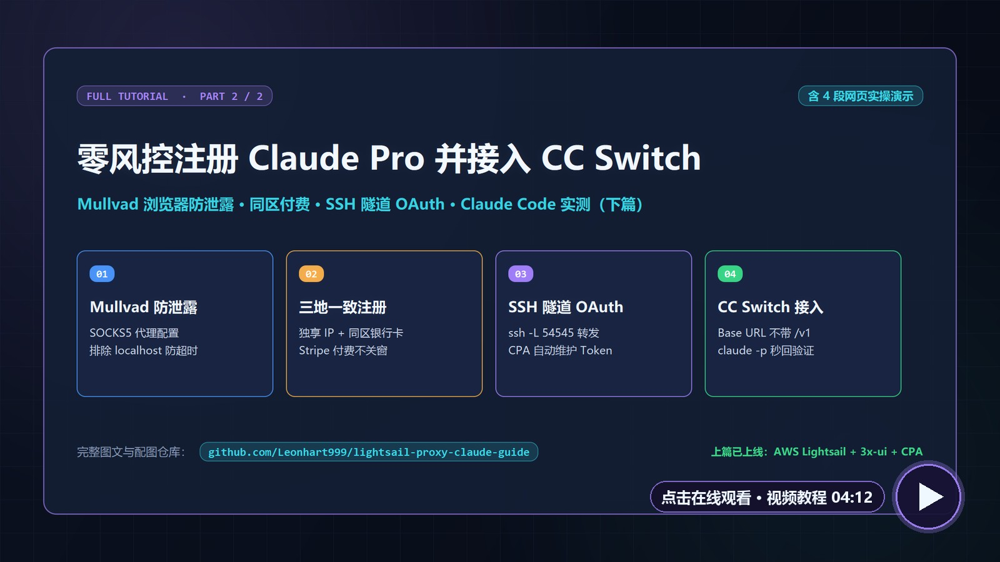
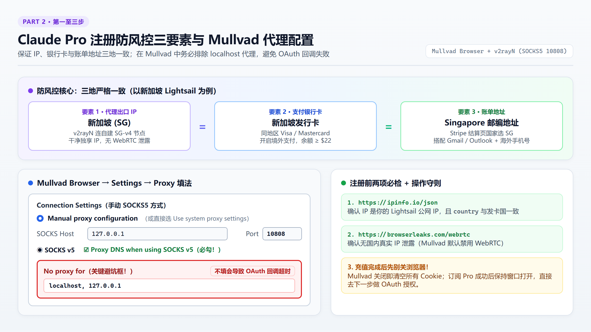
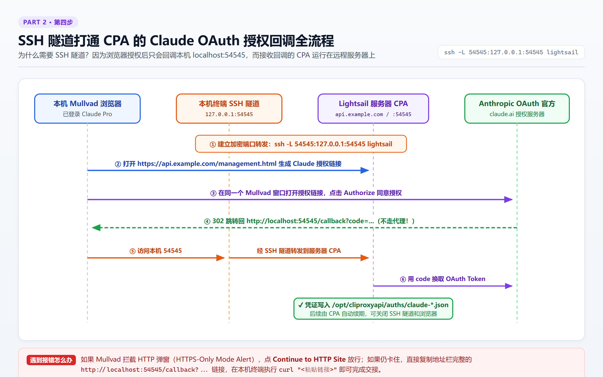
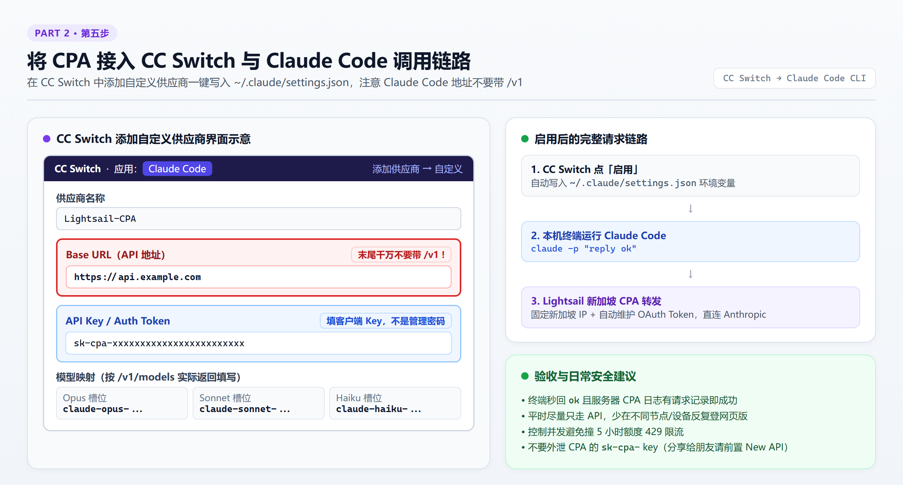

# 第二篇：Mullvad 浏览器注册 Claude Pro、OAuth 接入 CPA 与 CC Switch 配置教程

> 返回首页：[总览导航](../../README.md) ｜ 上一篇：[第一篇：AWS Lightsail 搭建代理节点、订阅网站、v2rayN 与 CPA](../part1-server-proxy-cpa/README.md)

在第一篇搭好自己的代理节点与 CPA 服务后，本篇带你安全走通 Claude Pro 的注册、订阅与 API 接入全流程：
1. 安装 **Mullvad 指纹浏览器** 与 **CC Switch**
2. 连接自建代理节点并完成防泄露自检
3. 使用**与服务器同地区的银行卡**注册并订阅 Claude Pro
4. 通过 **SSH 隧道**完成 Claude OAuth 登录到 CPA
5. 将 CPA 的 API 接入 **CC Switch** 并验证 Claude Code 调用

[](https://leonhart999.github.io/lightsail-proxy-claude-guide/#part2)

> **视频跟练（04:12，含 4 段网页实操演示）**：[在线播放（含章节快跳）](https://leonhart999.github.io/lightsail-proxy-claude-guide/#part2) ｜ [下载 MP4（21 MB）](https://github.com/Leonhart999/lightsail-proxy-claude-guide/releases/download/v1.0.0/Lightsail_Proxy_CPA_Part2.mp4) ｜ [下载 SRT 字幕](https://github.com/Leonhart999/lightsail-proxy-claude-guide/releases/download/v1.0.0/Lightsail_Proxy_CPA_Part2.srt)

> **防风控黄金法则**：**代理出口 IP 地区 = 银行卡发卡地区 = 账单地址地区**，且浏览器零指纹污染、无 WebRTC 真实 IP 泄露。

---

## 第一步：安装 Mullvad 指纹浏览器与 CC Switch

### 1.1 安装 Mullvad Browser

日常使用的 Chrome / Edge 中沉淀了大量本地 Cookie、扩展插件、系统字体与 WebRTC 内网/公网 IP 信息，直接拿去注册或付款很容易触发 Anthropic 和 Stripe 风控。**Mullvad Browser** 基于 Firefox ESR 深度强化，默认抹除浏览器指纹特征并彻底关闭 WebRTC，是注册海外服务的理想干净环境。

1. 前往官网 `https://mullvad.net/en/browser`（或 GitHub 发布页 `https://github.com/mullvad/mullvad-browser/releases`）下载 Windows 安装包。
2. 安装到非 C 盘路径（如 `D:\Programs\Mullvad Browser`）。
3. **关键特性须知**：Mullvad Browser 默认开启“永久隐私浏览”，**关闭窗口后会自动清空所有 Cookie 与登录态**。因此注册、充值、OAuth 授权请**在同一个窗口内一气呵成，中途不要关掉浏览器**，同时妥善记录邮箱密码。

### 1.2 安装 CC Switch

**CC Switch** 是一款开源桌面工具，用于可视化管理 Claude Code / Codex / Gemini CLI 的 API 地址、Key 与模型映射，免去手改 `~/.claude/settings.json` 的麻烦。

1. 前往 `https://github.com/farion1231/cc-switch/releases` 下载最新版 Windows 安装包或便携版。
2. 安装并打开，顶部应用切到 **Claude Code** 标签页备用。

---

## 第二步：连接自建代理节点与防泄露检测



### 2.1 在 v2rayN 中切换服务器同地区节点

1. 打开第一篇配置好的 **v2rayN**，选中你自建的 **IPv4 节点**（例如 `SG-v4-Reality-Vision` 或 `SG-v4-Hysteria2`，确保与你的银行卡归属地一致，下文以新加坡为例）。
2. 底部状态栏确认：
   - **系统代理**：`自动配置系统代理`
   - **路由**：`绕过大陆`
3. 留意界面左下角的本地混合监听端口（v2rayN 7.x 默认通常为 **`10808`**）。

### 2.2 配置 Mullvad Browser 走代理（含关键避坑项）

打开 Mullvad Browser → 右上角菜单 **Settings（设置）** → 搜索 `Proxy` → 点击 **Settings...**：

- **方式 A（推荐）**：直接选择 **Use system proxy settings（使用系统代理）**，会自动跟随 v2rayN 并绕过 `localhost`。
- **方式 B（手动 SOCKS5，适合防止系统代理未接管时）**：
  - 选择 **Manual proxy configuration**
  - **SOCKS Host**：`127.0.0.1` ｜ **Port**：`10808`（按你 v2rayN 实际端口填） ｜ 选中 **SOCKS v5**
  - **必勾**：`Proxy DNS when using SOCKS v5`（防止本地 DNS 泄露）
  - **最关键的一栏 — `No proxy for` 必须填入**：
    ```text
    localhost, 127.0.0.1
    ```
    > **不填必踩坑**：第四步 OAuth 回调地址是 `http://localhost:54545`，如果没把 `localhost` 加入免代理列表，浏览器会把回调流量发到新加坡服务器，导致授权超时失败！

### 2.3 注册前两项必检

在 Mullvad Browser 中打开下面两个网址逐一核对：

1. `https://ipinfo.io/json`：确认 `ip` 就是你 Lightsail 的静态公网 IP，`country` 为 `SG`（或你服务器所在国家）。
2. `https://browserleaks.com/webrtc`：确认页面未露出你的国内宽带 IP（Mullvad 默认禁用 WebRTC，不会显示任何泄露 IP）。

---

## 第三步：注册并充值 Claude Pro（同地区银行卡）

### 3.1 资料清单

- **海外邮箱**：推荐使用 **Gmail** 或 **Outlook**（尽量避免使用国内邮箱）。
- **海外手机号（首次接码）**：Anthropic 不支持 `+86` 大陆号码验证，请提前准备海外实体卡 / eSIM / 可靠海外号码接收短信验证码。
- **服务器同地区银行卡**：例如服务器在新加坡，就使用**新加坡发行的 Visa / Mastercard**（确保已开启境外线上/外币消费，卡内余额留足 `≥ $22` 覆盖 `$20` 月费及少量汇率预授权波动）。
- **同地区账单地址**：准备一套与银行卡发行国一致的真实格式地址和邮编（如新加坡街道地址 + 6 位邮编）。

### 3.2 注册与升级订阅

1. 在自检通过的 **Mullvad Browser** 中打开 `https://claude.ai`。
2. 输入邮箱接收验证码完成注册，再按提示完成海外手机号短信验证。
3. 进到主聊天页面后，可以先发一句普通问候（如 `"hi"`）确认账号正常，不要在刚注册时频繁刷新或发异常测试文本。
4. 点击左下角头像 → **Upgrade to Pro**（或访问 `https://claude.ai/upgrade`），建议先选**按月订阅（`$20/月`）**。
5. 在 Stripe 支付页填写银行卡信息和 **Billing Address**：
   - 国家/地区选择 **Singapore**（与你的代理 IP、发卡地严格一致）。
   - 完成 3DS 手机银行 App 确认后，界面出现 **Pro** 徽标即订阅成功。
6. **切记：此时不要关闭 Mullvad Browser 窗口**，直接进入第四步！

> **支付被拒排错**：不要在几分钟内连续多次换卡重试，否则容易触发 Stripe 永久风控。优先核对：① 卡是否开了境外线上扣款、② 余额是否略高于 `$20`、③ 出口 IP / 发卡地 / 账单地址三者是否一致。若网页 Stripe 仍受阻，也可同账号在移动端通过对应外区 Apple ID / Google Play 内购订阅 Pro（账号权益全平台同步）。

---

## 第四步：通过 OAuth 将 Claude 账号接入 CPA



### 4.1 本机建立 SSH 端口转发隧道

Anthropic 授权完成后会让浏览器跳转回 `http://localhost:54545/callback?...`，但监听 `54545` 端口的 CPA 运行在远端 Lightsail 上。因此需先在本机终端（PowerShell / Windows Terminal）运行：

```bash
ssh -L 54545:127.0.0.1:54545 lightsail
```

登录成功后**保持这个终端窗口开启不要关闭**。

### 4.2 在 Mullvad 浏览器中完成授权

1. 回到刚才已经登录了 Claude Pro 的 **Mullvad Browser**，新建一个标签页。
2. 打开你的 CPA 管理页：`https://api.example.com/management.html`（替换成你的域名），用第一篇设置的**管理密钥**登录。
3. 找到 **OAuth 登录**区域，选择 **Claude**，点击生成授权链接（Auth URL）。
4. **务必在当前同一个 Mullvad Browser 窗口的新标签页里打开该链接**（这样会复用已登录的 Claude Pro 会话，同时全程保持在新加坡干净 IP 下）。
5. 在 Anthropic 授权页点击 **Authorize（同意授权）**。

### 4.3 处理回调与常见拦截

授权后浏览器会自动跳转至 `http://localhost:54545/callback?code=...&state=...`：

- **正常情况**：经本机 SSH 隧道转发给服务器 CPA，页面提示授权成功，服务器上 `/opt/cliproxyapi/auths/` 自动生成 `claude-xxx.json` 凭证。
- **若 Mullvad 弹出 `HTTPS-Only Mode Alert` 阻止访问纯 HTTP 的 localhost**：
  - 直接点击页面上的 **Continue to HTTP Site** 放行；
  - 若依然打不开，**复制浏览器地址栏中完整的 `http://localhost:54545/callback?...` URL**，在本机另一个终端执行：
    ```bash
    curl "<粘贴你复制的完整 localhost:54545 回调链接>"
    ```
    即可手动把授权码交给 SSH 隧道完成绑定。

### 4.4 验证 CPA 模型列表

在本机终端运行（macOS / Linux 请去掉 `--ssl-no-revoke`）：

```bash
curl --ssl-no-revoke https://api.example.com/v1/models \
  -H "Authorization: Bearer sk-cpa-<你的CPA客户端API_Key>"
```

若返回列表中出现 `claude-opus-...`、`claude-sonnet-...`、`claude-haiku-...`，代表 OAuth 接入完全成功！**记下输出里准确的模型 ID**，下一步需要用到。

此时可以安全关闭本机的 `ssh -L 54545:...` 窗口以及 Mullvad Browser（后续 CPA 会在服务器端自动刷新 OAuth Token）。

---

## 第五步：把 CPA 的 API 接入 CC Switch 并开始使用



### 5.1 在 CC Switch 中添加自定义供应商

1. 打开 **CC Switch**，顶部应用选择 **Claude Code**。
2. 点击 **添加供应商（Add Provider）→ 自定义（Custom）**，按如下填写：
   - **供应商名称**：自定义，例如 `Lightsail-CPA`
   - **Base URL / API 地址**：
     ```text
     https://api.example.com
     ```
     > **关键细节**：接入 **Claude Code** 时末尾**绝对不要带 `/v1`**（Claude Code 会自动拼接 `/v1/messages`）。仅当在 Cherry Studio、Chatbox、Codex 等 OpenAI 协议客户端中使用时才填 `https://api.example.com/v1`。
   - **API Key / Auth Token**：填第一篇 `config.yaml` 中 `access.api-keys` 里的客户端 Key（`sk-cpa-...`），**不是管理密钥**。
   - **模型映射（Opus / Sonnet / Haiku）**：按第 4.4 步 `/v1/models` 实际返回的模型名称对应填入。
3. 保存后点击该供应商卡片上的 **启用（Enable / Switch）**，CC Switch 会自动将配置写入 `C:\Users\<用户名>\.claude\settings.json`。

### 5.2 安装并测试 Claude Code

如果本机还未安装 Claude Code（需预先安装 Node.js）：

```bash
npm install -g @anthropic-ai/claude-code
```

新开一个终端窗口，运行一条非交互命令测试连通性：

```bash
claude -p "reply ok"
```

终端正常回复 `ok`，且在服务器上执行 `ssh lightsail sudo docker logs --tail 20 cli-proxy-api` 能看到刚发出的请求日志，就说明全链路打通了！之后在任意项目目录直接执行 `claude` 即可开始编程。

---

## 第六步：账号保活与日常避坑建议

1. **尽量固定通过 CPA 使用，减少频繁跨 IP 登网页版**：接入 CPA 后，所有 API 请求统一由你的新加坡 Lightsail 固定 IP 发出，比在多个机场节点和手机之间切换登录网页端稳得多。
2. **注意 5 小时窗口额度与并发**：Pro 订阅受动态滚动窗口限制，若 Claude Code 同时拉起过多子代理或超高并发，可能触发 429 限流，等待冷却恢复即可，不要短时间反复猛刷重试。
3. **保护好你的 CPA Key**：`sk-cpa-...` 具备调用 CPA 全部模型的权限且无按人限额，切勿外传；若后续需要分享给朋友使用，建议在 CPA 前面再部署一层 **New API** 网关按人发子 Key 并限制可用模型。
4. **备份关键目录**：定期备份服务器上的 `/opt/cliproxyapi/config.yaml` 与 `/opt/cliproxyapi/auths/`（妥善离线加密保存，切勿上传网盘公开链接或 GitHub）。
